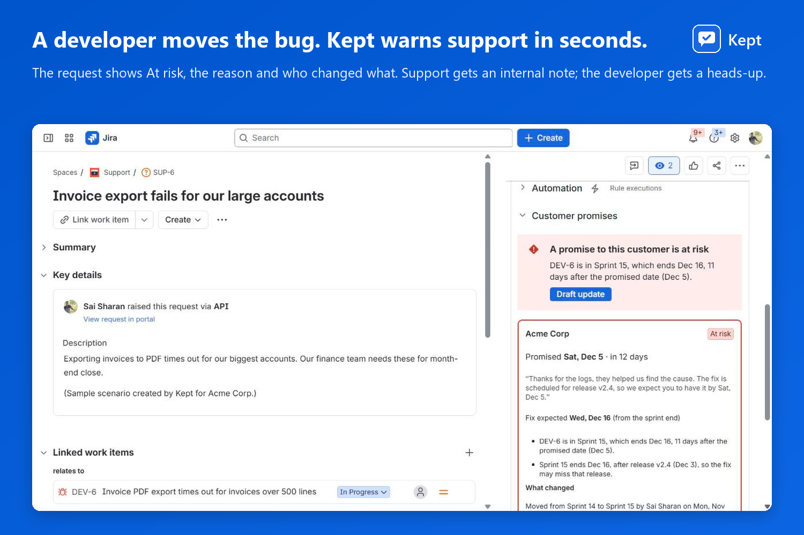
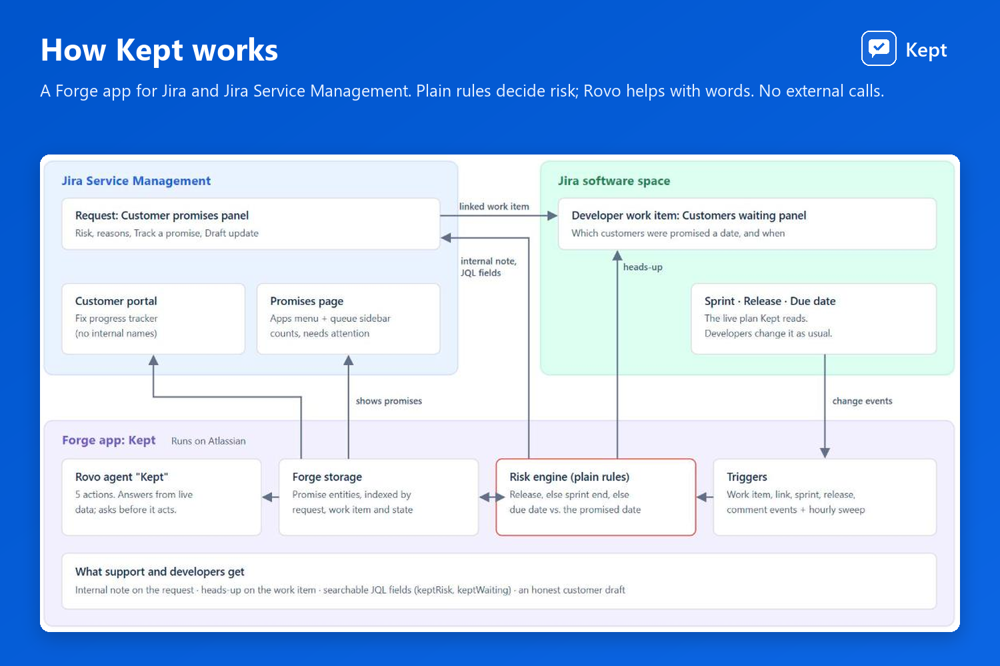
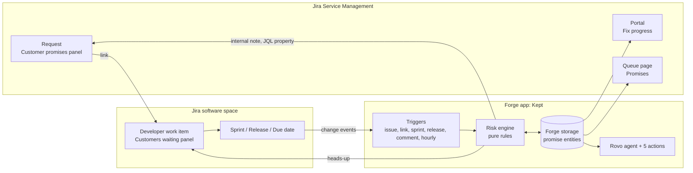

# Kept

**Kept tells support the moment an engineering change breaks a promise made to a customer, and drafts the honest update.**

A Forge app for Jira Service Management, Jira and Rovo. Built for Codegeist 2026 (category: Apps for Business Teams; bonus: Best Rovo Agents).

- **Install link:** [Install Kept on your Jira site](https://developer.atlassian.com/console/install/3471444e-dcdc-45df-867b-a9624ec8ceb4?signature=AYABePFXvQezj2B7y3EZWTy9oPgAAAADAAdhd3Mta21zAEthcm46YXdzOmttczp1cy13ZXN0LTI6NzA5NTg3ODM1MjQzOmtleS83MDVlZDY3MC1mNTdjLTQxYjUtOWY5Yi1lM2YyZGNjMTQ2ZTcAuAECAQB4CxqLTo9l4lqXuFjNim1xJM%2Bp%2F3TVP9xHS2BrU5DRRucB8%2FwcgDIphpJmDvvRG79fQAAAAH4wfAYJKoZIhvcNAQcGoG8wbQIBADBoBgkqhkiG9w0BBwEwHgYJYIZIAWUDBAEuMBEEDBCGkL8IeY3s1eRVbQIBEIA7lQJylhvv0r25eEKX3nJgznM3JZ9QeJ7wKGP2qL3gTKcWhppUheNlcM%2FSYPvu2eAKgjG7Isy3%2BdSkyHsAB2F3cy1rbXMAS2Fybjphd3M6a21zOmV1LXdlc3QtMTo3MDk1ODc4MzUyNDM6a2V5LzQ2MzBjZTZiLTAwYzMtNGRlMi04NzdiLTYyN2UyMDYwZTVjYwC4AQICAHi9bVMAkme4qVQX1fQHo6ePw3H40A7cGfz7yrmSfBWMXgHxWG%2BzV7NFaEWwOqWWhqhfAAAAfjB8BgkqhkiG9w0BBwagbzBtAgEAMGgGCSqGSIb3DQEHATAeBglghkgBZQMEAS4wEQQMl21YHTRkLBKy%2FvnWAgEQgDt%2FHSoSA0HwHV52w6v0jZfnfgJOvWjle5dCPT%2F1fENOri8qH%2F4Eb%2FV2%2B%2FH0xAY%2BbNtpA6bEcIsl3ObyvQAHYXdzLWttcwBLYXJuOmF3czprbXM6dXMtZWFzdC0xOjcwOTU4NzgzNTI0MzprZXkvNmMxMjBiYTAtNGNkNS00OTg1LWI4MmUtNDBhMDQ5NTJjYzU3ALgBAgIAeDYASx0XCjkny4iLV6vz%2BKtEGSGT6kdt0QRpkn6D%2FlVEAeeUv14PjGlYzRiXP6Myx6cAAAB%2BMHwGCSqGSIb3DQEHBqBvMG0CAQAwaAYJKoZIhvcNAQcBMB4GCWCGSAFlAwQBLjARBAw5MERuuDBWUa2rEEwCARCAO%2FgtUzBzeQ121YacIt%2F663gBEopHBdJiPAGxFIptBXmxoDerDCZtqrZqVOu5VxHjcYKfLlbjNT2MCuINAgAAAAAMAAAQAAAAAAAAAAAAAAAAAD0q7iu5VhDIvBSP49mBol7%2F%2F%2F%2F%2FAAAAAQAAAAAAAAAAAAAAAQAAADK3iBXqBTL1XIkBBQ3v7pcoelxLjeNKBDI1%2F9oM%2Fq98FMe0mKe99BStkn%2FTk0oJGIppiiRqfHUBVfmD0AxL1Xp6CQw%3D&product=jira) (pick your site, then accept the permissions)
- **Code:** https://github.com/saisharandomakonda/kept
- **Demo video:** _added before submission_
- **Devpost:** _added before submission_



More screenshots: [Promises page](docs/images/promises-page.png) · [Rovo agent](docs/images/rovo.png) · [Draft update](docs/images/draft-update.png) · [Customer portal](docs/images/portal.png)

---

## The problem

A support agent tells a customer: "The fix ships in release 2.4, on Dec 10." The fix lives in a developer's work item in another space. A week later a developer moves that work item to the next sprint. Nobody tells support. The customer finds out on Dec 10, when nothing arrives.

Jira has no idea a promise was made, so nothing can warn anyone. Teams have also asked Atlassian since 2017 to show customers the linked engineering work on the portal ([JSDCLOUD-4636](https://jira.atlassian.com/browse/JSDCLOUD-4636), 859 votes). Kept's portal panel is a safe version of that.

## What Kept does

1. **Records the promise.** Track it from the request panel, ask Rovo, or let Kept spot it in the agent's reply ("we expect the fix by Friday, Dec 4") and suggest it.
2. **Follows the fix chain.** Request → linked developer work item → sprint, release and due date.
3. **Re-checks on every change.** Sprint moves, release date changes, status changes, link changes, plus an hourly sweep. Within seconds of a slip:
   - the request's **Customer promises** panel turns **At risk** and says why ("TD-11 is in Sprint 15, which ends Dec 13, 11 days after the promised date (Dec 2)"), and who moved it;
   - an **internal note** (agents only) is added to the request;
   - a **heads-up** on the developer's work item names the customer who is waiting;
   - JQL fields update, so `keptRisk = "at-risk"` works in filters and queues.
4. **Helps tell the customer.** **Draft update** writes an honest, editable message with a new date taken from the live plan (plan date plus a safety margin), and warns you if that date will still be tight. Send it, and the new date becomes the new promise. The old one is marked "replaced".
5. **Shows safe progress to the customer.** A **Fix progress** tracker on the portal, only on requests where support gave the customer a date: Reported → Confirmed → In development → Fixed → Released. No internal names, keys or sprints. The planned date shows only if an admin turns it on.
6. **Gives leads one view.** The **Promises** page (**Apps → Kept**, and **Promises** in a service space's queue sidebar) shows the counts, what needs attention, and the kept-on-time rate.
7. **Rovo agent "Kept".** Ask "Which customer promises are at risk this week, and what should we tell each customer?". It answers from live data with request keys and reasons. It can track a promise or post an update, always after you confirm. See [The Rovo agent](#the-rovo-agent).

Risk is decided by **plain, explainable rules**, not AI: release date, else sprint end, else due date, compared with the promised date and a safety margin. Every warning carries its reasons. AI (Rovo) only helps with words, and a person always sends.

## Try it (judges)

**You need:** a Jira Cloud site with **Jira Service Management** (the Free plan works) and a **software space**. A Scrum space makes the sprint story richer; without one, Kept uses releases and due dates. **Rovo** is needed only for the agent (step 6). Our Codegeist demo site (`forge site provision`) had all of this.

1. **Install** Kept with the install link above. Accept the permissions.
2. Go to **Apps → Kept** (the Promises page). Under **Sample scenario**, pick a service space and a software space, then click **Load sample scenario** (about 30–60 seconds). It creates 5 customer requests and the developer work items behind them, sprints **Sprint 14** and **Sprint 15** (if the space has a Scrum board), releases **v2.3** and **v2.4**, and promises in different states. Everything is labelled `kept-sample`.
3. The sample card now links each request by customer. Open **Acme Corp** ("Invoice export fails for our large accounts"). In the right column, **Customer promises** shows **On track**, and the plan behind it.
4. **The slip:** in the right column, under **Developer work**, open the linked work item ("Invoice PDF export times out…").
   - With a Scrum board (company- or team-managed): change its **Sprint** field from Sprint 14 to **Sprint 15**.
   - Without sprints (for example a Kanban space): change its **Due date** to three weeks later.

   Go back to the Acme request and refresh. Within about 10–30 seconds it shows **At risk**, with the reason and who made the change. There's an internal note on the request and a heads-up on the work item. Search `keptRisk = "at-risk"` to find it.
5. On the Acme request, click **Draft update**. Keep Kept's suggested date (or pick your own), edit the message if you like, and click **Send to customer**. The customer gets a public reply. The new date is tracked, and the old promise shows as replaced. (In the sprint story the bug is still tagged release v2.4, which ships before Sprint 15 ends, so the new promise shows **Tight** until a developer moves it to a later release. The draft window tells you this.)
6. Click **Ask Rovo** on the Promises page, or chat with the **Kept** agent in Rovo. Prompts to try are in [The Rovo agent](#the-rovo-agent).
7. Optional: on the request, click **View request in portal** (under "raised this request", above the description) to see **Fix progress** as the customer sees it, under **Apps**. Open **Jira settings → Apps → Kept** for settings. **Remove sample data** (on the Promises page) deletes everything the sample created.
8. **Try it on your own data** (2 minutes). Open any request in a service space that's linked to a work item in a software space (**Link work item** → "relates to"). In **Customer promises**, click **Track a promise**, pick the date you gave, and save. Then change that work item's **Sprint** or **Due date** to after the promised date. The request turns **At risk** within seconds. Nothing here comes from the sample.

The other sample stories show the other states: **Globex** is tight (the sprint ends 1 day before the promise), **Initech** is at risk (the fix has no plan at all), **Umbrella** was delivered, and **Hooli** has a promise Kept spotted in a reply, waiting for you to **Track** or **Dismiss** it.

## The Rovo agent

The **Kept** agent works from the same live data and rules as the panels. Try these, in order (use the request keys from your sample card):

1. "Which customer promises are at risk this week, and what should we tell each customer?" It lists each promise with the request key, the reason, and a short message per customer.
2. "Why is SUP-11 late?" (the Acme request). It explains the change from the history, for example the sprint move and who made it.
3. "Find promises in the replies on SUP-15 and track the one you find." (the Hooli request). It quotes the sentence, confirms the date with you in plain words, then tracks it. Rovo shows its own confirm card before anything is saved.
4. "Initech's fix (SUP-13) has no plan. Draft a check-in for them, then send it." With no plan it commits to a check-in date instead of inventing a fix date. It sends only after you say so and confirm Rovo's card.

**Guardrails:**
- It only sees promises in spaces you can browse, and work items you can open.
- New dates come from Kept's rules (`suggestedNewDate`), the same date the panel suggests. The agent never invents one.
- Actions that change data (track a promise, post a customer update) need your explicit go-ahead and Rovo's confirm card.
- `post-customer-update` refuses text that mentions sprints, the backlog, Jira or a real work item key, so internal details can't reach a customer. Ordinary words like "UTF-8" are fine.
- Your identity comes from the Rovo context, not from anything the model types.

**Rules and AI together:** plain rules find promises in replies for free (dates like "by Friday" or "end of next week"). The agent catches wording the rules miss, and writes the message. Risk is always decided by rules.

## How it works



<details><summary>Same diagram as text (Mermaid)</summary>



</details>

- **Forge modules:** `jira:issueContext` ×2 (with live status badges), `jira:globalPage`, `jiraServiceManagement:queuePage`, `jiraServiceManagement:portalRequestDetail`, `jira:adminPage`, `jira:entityProperty` (JQL), `trigger` ×5, `scheduledTrigger`, `rovo:agent`, `action` ×5.
- **UI:** UI Kit (`@forge/react`) with Atlassian Design System components and design tokens only, (no hard-coded colours, except the chart's four status colours), so it follows Jira's look and theme.
- **Storage:** Forge KVS custom entities with indexes (by request, by developer item, by state).
- **No external calls.** The core needs no AI; the optional agent uses your site's Rovo. `forge eligibility` confirms the production version qualifies for Atlassian's "Runs on Atlassian" program.

More detail: [docs/ARCHITECTURE.md](docs/ARCHITECTURE.md) · [docs/DATA-AND-PRIVACY.md](docs/DATA-AND-PRIVACY.md) · [docs/TEST-PLAN.md](docs/TEST-PLAN.md)

## What is real and what is simulated

- **Everything you see is real Jira data and real Forge behaviour.** The sample scenario creates real requests, work items, sprints and releases in your spaces, and real promises. When you move a work item, real Jira events drive the warning.
- **Sample-only shortcut:** the app can't receive events for changes it makes itself, so while loading the sample it runs promise detection on its own replies directly. When a person replies, the normal comment event triggers detection.
- **Not built (on purpose):** no automatic emails to customers (a person always sends) and no AI-decided risk (rules you can read and test).

## Known limits

- One developer work item per promise. If a request links to several, you pick which one the promise depends on.
- Promise detection reads English date phrases ("by Friday", "end of next week", "Dec 10").
- Dates are calendar days in UTC; there's no business-day or holiday calendar yet.
- Items in a service space aren't treated as developer work, so link requests to a software space.
- On portal requests without a promise, Kept shows nothing, but Jira still shows the app's "Fix progress" title under **Apps**.

## Develop

Requires Node 24 and the Forge CLI (`npm i -g @forge/cli`).

```bash
npm install
npm run verify                  # type check + lint + 134 tests (domain rules and end-to-end services against in-memory fakes)
forge register                  # once, if you forked this repo
forge deploy -e development
forge install --product jira    # pick your site
forge logs -e development       # see what the triggers did
```

Code map: `src/domain/` (pure rules, no Forge imports) · `src/jira/` (REST adapters) · `src/store/` (storage) · `src/services/` (use cases) · `src/handlers/` (Forge entry points) · `src/frontend/` (UI Kit screens) · `resources/agent/prompt.md` (Rovo agent instructions). There are no secrets or API keys; `.env` is not used.

## AI disclosure

Built with AI assistance using **Claude Code** (Anthropic): planning, code, tests and docs, reviewed and tested by a person on a live Jira site. The app itself uses **Rovo** for its agent and no other AI service.

## License

MIT. See [LICENSE](LICENSE).
