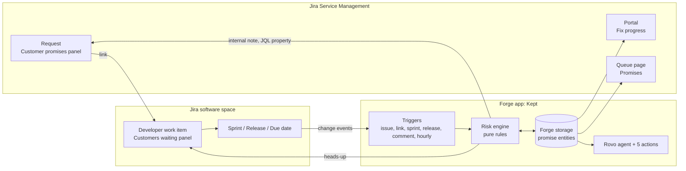

# Kept

**Kept tells support the moment an engineering change breaks a promise made to a customer, and drafts the honest update.**

A Forge app for Jira Service Management, Jira and Rovo. Built for Codegeist 2026 (category: Apps for Business Teams; bonus: Best Rovo Agents).

- **Install link:** _added before submission_
- **Demo video:** _added before submission_
- **Devpost:** _added before submission_

---

## The problem

A support agent tells a customer: "The fix ships in release 2.4, on Dec 10." The fix lives in a developer's work item in another space. A week later a developer moves that work item to the next sprint. Nobody tells support. The customer finds out on Dec 10, when nothing arrives.

Jira has no idea a promise was made, so nothing can warn anyone. Teams have also asked Atlassian since 2017 to show customers the linked engineering work on the portal ([JSDCLOUD-4636](https://jira.atlassian.com/browse/JSDCLOUD-4636), 859 votes). Kept's portal panel is a safe version of that.

## What Kept does

1. **Records the promise.** Track it from the request panel, ask Rovo, or let Kept spot it in the agent's reply ("we expect the fix by Friday, Dec 4") and suggest it.
2. **Follows the fix chain.** Request → linked developer work item → sprint, release and due date.
3. **Re-checks on every change.** Sprint moves, release date changes, status changes, link changes, plus an hourly sweep. Within seconds of a slip:
   - the request's **Customer promises** panel turns **At risk** and says why ("TD-11 is in Sprint 15, which ends Dec 13, 11 days after the promised date (Dec 2)"), and who moved it;
   - an **internal note** (agents only) is added to the request;
   - a **heads-up** on the developer's work item names the customer who is waiting;
   - JQL fields update, so `keptRisk = "at-risk"` works in filters and queues.
4. **Helps tell the customer.** **Draft update** writes an honest, editable message with a realistic new date. Send it, and the new date becomes the new promise. The old one is marked "replaced".
5. **Shows safe progress to the customer.** A **Fix progress** tracker on the portal: Reported → Confirmed → In development → Fixed → Released. No internal names, keys or sprints. The planned date shows only if an admin turns it on.
6. **Gives leads one view.** The **Promises** page (Apps menu, and the service space queue sidebar) shows the counts, what needs attention, and the kept-on-time rate.
7. **Rovo agent "Kept".** Ask "Which customer promises are at risk this week, and what should we tell each customer?". It answers from live data with request keys and reasons. It can track a promise or post an update, always after you confirm.

Risk is decided by **plain, explainable rules**, not AI: release date, else sprint end, else due date, compared with the promised date and a safety margin. Every warning carries its reasons. AI (Rovo) only helps with words, and a person always sends.

## Try it (judges)

**You need:** a Jira Cloud site with **Jira Service Management** (the Free plan works) and a **software space**. A Scrum space makes the sprint story richer; without one, Kept uses releases and due dates. **Rovo** is needed only for the agent (step 6). Our Codegeist demo site (`forge site provision`) had all of this.

1. **Install** Kept with the install link above. Accept the permissions.
2. Go to **Apps → Kept**. Under **Sample scenario**, pick a service space and a software space, then click **Load sample scenario** (about 30–60 seconds). It creates 5 customer requests and the developer work items behind them, sprints **Sprint 14** and **Sprint 15** (if the space has a Scrum board), releases **v2.3** and **v2.4**, and promises in different states. Everything is labelled `kept-sample`.
3. The sample card now links each request by customer. Open **Acme Corp** ("Invoice export fails for our large accounts"). In the right column, **Customer promises** shows **On track**, and the plan behind it.
4. **The slip:** in the right column, under **Developer work**, open the linked work item ("Invoice PDF export times out…").
   - With a Scrum board: change its **Sprint** field from Sprint 14 to **Sprint 15**.
   - Without one: open **Releases** in the software space, edit **v2.4**, and move its release date a few weeks later.

   Go back to the Acme request and refresh. Within about 10–30 seconds it shows **At risk**, with the reason and, for a sprint move, who made it. There's an internal note on the request and a heads-up on the work item. Search `keptRisk = "at-risk"` to find it.
5. On the Acme request, click **Draft update**, pick a new date, and send. The customer gets a public reply. The new date is tracked, and the old promise shows as replaced.
6. Click **Ask Rovo** on the Promises page, or chat with the **Kept** agent in Rovo.
7. Optional: on the request, click **View request in portal** (under the description) to see **Fix progress** as the customer sees it. Open **Jira settings → Apps → Kept** for settings. **Remove sample data** (on the Promises page) deletes everything the sample created.

The other sample stories show the other states: **Globex** is tight (the sprint ends 1 day before the promise), **Initech** is at risk (the fix has no plan at all), **Umbrella** was delivered, and **Hooli** has a promise Kept spotted in a reply, waiting for you to **Track** or **Dismiss** it.

## How it works



- **Forge modules:** `jira:issueContext` ×2 (with live status badges), `jira:globalPage`, `jiraServiceManagement:queuePage`, `jiraServiceManagement:portalRequestDetail`, `jira:adminPage`, `jira:entityProperty` (JQL), `trigger` ×5, `scheduledTrigger`, `rovo:agent`, `action` ×5.
- **UI:** UI Kit (`@forge/react`) with Atlassian Design System components and design tokens only, so it matches Jira, including dark mode.
- **Storage:** Forge KVS custom entities with indexes (by request, by developer item, by state).
- **No external calls and no paid AI.** Rovo comes with the site. The Forge CLI reports each deploy as eligible for Atlassian's "Runs on Atlassian" program.

More detail: [docs/ARCHITECTURE.md](docs/ARCHITECTURE.md) · [docs/DATA-AND-PRIVACY.md](docs/DATA-AND-PRIVACY.md) · [docs/TEST-PLAN.md](docs/TEST-PLAN.md)

## What is real and what is simulated

- **Everything you see is real Jira data and real Forge behaviour.** The sample scenario creates real requests, work items, sprints and releases in your spaces, and real promises. When you move a work item, real Jira events drive the warning.
- **Sample-only shortcut:** the app can't receive events for changes it makes itself, so while loading the sample it runs promise detection on its own replies directly. When a person replies, the normal comment event triggers detection.
- **Not built (on purpose):** no automatic emails to customers (a person always sends) and no AI-decided risk (rules you can read and test).

## Develop

Requires Node 24 and the Forge CLI (`npm i -g @forge/cli`).

```bash
npm install
npm run verify                  # type check + lint + 125 tests (domain rules and end-to-end services against in-memory fakes)
forge register                  # once, if you forked this repo
forge deploy -e development
forge install --product jira    # pick your site
forge logs -e development       # see what the triggers did
```

Code map: `src/domain/` (pure rules, no Forge imports) · `src/jira/` (REST adapters) · `src/store/` (storage) · `src/services/` (use cases) · `src/handlers/` (Forge entry points) · `src/frontend/` (UI Kit screens) · `resources/agent/prompt.md` (Rovo agent instructions). There are no secrets or API keys; `.env` is not used.

## AI disclosure

Built with AI assistance using **Claude Code** (Anthropic): planning, code, tests and docs, reviewed and tested by a person on a live Jira site. The app itself uses **Rovo** for its agent and no other AI service.

## License

MIT. See [LICENSE](LICENSE).
